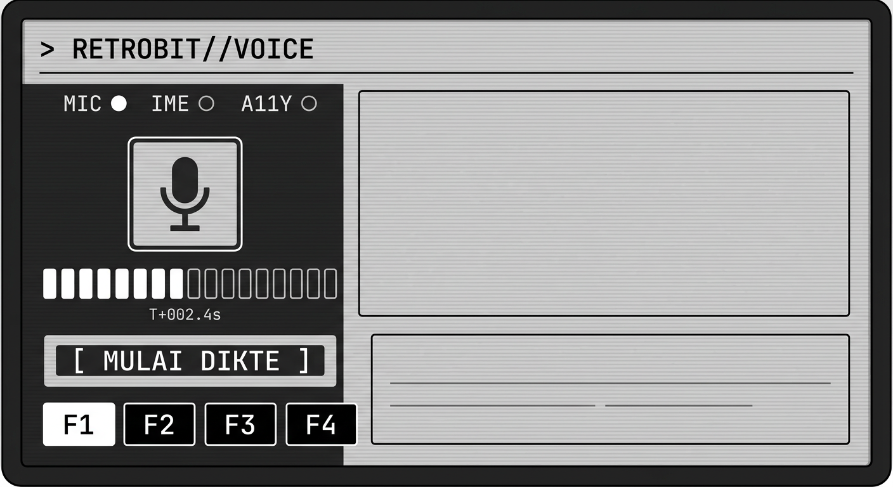

# Retrobit Voice

[](https://github.com/retrobit-dev/Retrobit-voice/actions/workflows/build.yml)

**Dikte secepat bicara + asisten suara Bahasa Indonesia — dua-duanya dalam satu aplikasi Android native.**

Retrobit Voice menggabungkan dua hal yang biasanya terpisah:

| Bagian | Meniru | Yang Anda dapat |
| --- | --- | --- |
| **Mode Dikte** | Wispr Flow | Ucapan langsung menjadi teks rapi di aplikasi apa pun — WhatsApp, Gmail, Notes, kolom pencarian |
| **Mode Asisten** | Google Assistant | "Buka WhatsApp", "telepon Ibu", "alarm jam 5 pagi", "timer 10 menit", "nyalakan senter", dan tanya-jawab bebas |

Dirancang **offline-first**: dikte dan puluhan perintah tetap jalan tanpa internet, lalu meningkat otomatis kalau Anda memasukkan API key milik Anda sendiri (BYOK).

---

## Fitur utama

### Dikte (Wispr Flow style)
- **Keyboard Retrobit** — IME khusus dengan tombol mikrofon; hasil bicara langsung masuk di posisi kursor.
- **Bubble melayang kontekstual** — hanya muncul saat kolom teks fokus (ketuk = dikte hands-free dengan waveform dan auto-stop hening, tekan lama = asisten).
- **Sisipkan langsung lewat aksesibilitas** — bubble memasukkan hasil ke kursor tanpa clipboard. Jika jalur langsung tidak tersedia, Retrobit melaporkan kegagalan alih-alih menyalin diam-diam.
- **Mesin STT hybrid** — satu rekaman dicoba berurutan:
  1. **on-device** (Google recognizer, Android 12+, privat & gratis),
  2. **cloud** (OpenAI / Groq / Deepgram) kalau langkah pertama gagal,
  3. pesan diagnostik jelas kalau keduanya gagal.
- **Pembersihan teks dua tingkat** — aturan lokal (buang "eee/emm/anu", perbaiki tanda baca, huruf besar) atau LLM untuk hasil yang lebih natural.
- **Auto-stop saat berhenti bicara** — detektor aktivitas suara (VAD) dengan noise floor adaptif.
- **Pintasan tombol volume** — tahan Volume Atas sekitar 0,7 detik untuk asisten/voice command; tahan Volume Bawah untuk mulai dikte dan lepas untuk selesai. Ketukan singkat tetap menaikkan/menurunkan volume. Masing-masing pintasan dapat diaktifkan di Pengaturan dan memerlukan aksesibilitas.
- **Wake word kontekstual** — saat kolom teks fokus, wake word memulai dikte dan menyisipkan teks di kursor; di luar mode mengetik, wake word membuka sesi perintah asisten.
- Pemicu tile **Pengaturan Cepat** Android.

### Asisten (Google Assistant style)
- **Kaskade cerdas**: aturan lokal → LLM (opsional) → fallback pencarian web. Artinya asisten tetap berguna tanpa API key.
- Perintah yang dikenali secara offline: buka aplikasi, cari di web/YouTube/Maps/Tokopedia, telepon kontak atau nomor, alarm, timer, pesan, catatan, senter, volume, dan panel pengaturan.
- **Konteks layar opt-in** — snapshot teks layar hanya dipakai saat pengguna meminta membaca/membalas chat. Teks dikecualikan dari riwayat dan hanya dikirim ke LLM terpilih untuk permintaan kontekstual.
- **Kirim pesan selalu perlu konfirmasi eksplisit** — setelah setuju, Retrobit membuka draf WhatsApp; pengguna memeriksa dan menekan Kirim di WhatsApp.
- **Bisa dipilih sebagai asisten digital bawaan** (`VoiceInteractionService`) — tekan lama tombol Home langsung mendengarkan dan mengucapkan prompt siap.
- **Kata kunci panggilan** opsional ("hai retro"), dengan catatan baterai yang jujur di pengaturan.
- Jawaban dibacakan dengan TTS bawaan Android.

### Privasi
- API key disimpan **terenkripsi** dengan Android Keystore.
- Audio **dihapus segera** setelah transkripsi.
- Riwayat hanya tersimpan di perangkat, bisa dimatikan sekali sentuh — tidak ada server milik proyek ini.
- Akses konteks layar **mati secara bawaan**; bila diaktifkan, snapshot hanya diteruskan ke LLM pilihan saat perintah meminta membaca/membalas layar, dan tidak disimpan di riwayat.
- Tidak ada analytics, tidak ada iklan, tidak ada pengiriman data diam-diam. Pesan tidak pernah dikirim tanpa konfirmasi dan tap Kirim di aplikasi tujuan.

---

## Tampilan: retro cyberdeck, grayscale e-paper



> Ilustrasi arah visual (bukan tangkapan layar aplikasi): panel bergaris, tipografi
> monospace, meter LED 1-bit, dan tombol ter-inversi. Untuk melihat hasil aslinya,
> pasang APK dari halaman **Releases**.

Seluruh antarmuka mengikuti estetika **layar e-paper 1-bit**: hanya ada tinta dan kertas,
tanpa satu pun warna.

- **Status dibawa oleh glyph, bukan warna** — `●`/`○` untuk perangkat, `■`/`□` untuk langkah
  aktivasi, `▚` untuk panel aktif, `!` untuk galat, `>`/`<` untuk log masuk/keluar.
  Ini bukan pilihan gaya, melainkan konsekuensi: di layar monokrom warna tidak bisa diandalkan.
- **Inversi sebagai penanda "aktif"** — tombol mikrofon berubah menjadi balok penuh tinta saat
  merekam; tab navigasi ter-inversi saat dipilih.
- **Tipografi monospace, sudut tajam (0–2dp), garis tepi 1px**, plus tekstur scanline halus
  (`Modifier.epaperTexture()`) agar terasa seperti panel perangkat, bukan kartu Material.
- **Bilah navigasi sendiri** (bukan `NavigationBar` Material) bergaya tombol instrumen F1–F4.
- **Dua mode permukaan**: **DECK** (panel gelap, bawaan) dan **PAPER** (kertas terang seperti
  e-reader) — bisa diganti di *Pengaturan → Mode tampilan*.

Keyboard dikte dan bubble melayang mengikuti bahasa visual yang sama: persegi tanpa lengkung,
dengan bubble yang terisi penuh tinta saat merekam.

## Alur kerja

```
        ┌────────────┐   tekan mikrofon   ┌──────────────┐   transkripsi   ┌──────────────┐
Anda ──►│ Keyboard / │ ─────────────────► │  Rekaman WAV │ ──────────────► │ Teks mentah  │
        │ Bubble     │                    │  16 kHz mono │  on-device →    │ (transkrip)  │
        └────────────┘                    └──────────────┘  cloud          └──────┬───────┘
                                                                                   │ pembersihan
                                            ┌──────────────┐   penempelan   ┌─────▼───────┐
                                            │ WhatsApp,    │ ◄──────────────│ Teks rapi   │
                                            │ Gmail, dll.  │  IME / a11y    └─────────────┘
                                            └──────────────┘  langsung
```

---

## Unduh APK (tanpa memasang Android Studio)

**Cara termudah — halaman Releases:**

1. Buka tab **Releases** di repositori ini.
2. Pilih release **Build terbaru**.
3. Unduh:
   - **`app-release.apk`** (±1,5 MB) — versi rilis, sudah diminifikasi & ditandatangani. **Pakai ini.**
   - `app-debug.apk` (±10 MB) — versi debug, untuk melaporkan masalah dengan log lengkap.
4. **Uninstall versi lama lebih dulu**, lalu buka berkas di ponsel → izinkan "Instal dari sumber tidak dikenal" bila diminta.

Release dibuat otomatis oleh CI setiap kali `main` diperbarui, jadi tidak perlu login untuk mengunduh.

**Alternatif (butuh login GitHub):** tab **Actions** → workflow **Build APK** → **Artifacts**.

> ⚠️ **Setiap build ditandatangani kunci sekali pakai.** Repositori ini tidak menyimpan keystore
> permanen, jadi tanda tangan APK berbeda di tiap build dan Android **menolak** pemasangan yang
> menimpa versi lama (`INSTALL_FAILED_UPDATE_INCOMPATIBLE`) — uninstall selalu diperlukan.
>
> Karena uninstall juga menghapus setelan, riwayat, dan API key (kunci penyimpanan ikut terhapus),
> jalankan **Pengaturan → Cadangan setelan → Ekspor** sebelum mengganti versi, lalu **Impor**
> setelah versi baru terpasang. Berkas cadangan memuat API key dalam bentuk teks biasa — simpan
> di tempat aman.
>
> Konsekuensi lain dari keputusan ini: jalur **Play Store tertutup** selama tidak ada keystore
> tetap, karena unggahan ke Play wajib ditandatangani kunci yang Anda simpan sendiri.

## Cara build

Butuh **Android Studio Ladybug (2024.2)** atau lebih baru, JDK 17, dan Android SDK 35.

```bash
git clone https://github.com/retrobit-dev/Retrobit-voice.git
cd Retrobit-voice
./gradlew assembleDebug          # APK: app/build/outputs/apk/debug/
./gradlew testDebugUnitTest      # uji parser, pembersih teks, cadangan setelan (JVM, tanpa emulator)
./gradlew lintDebug              # temuan bertingkat error menggagalkan build
python3 tools/verify_project.py  # pemeriksa konsistensi resource/manifest (tanpa Android SDK)
```

CI GitHub Actions (`.github/workflows/build.yml`) menjalankan unit test, **Lint**, dan APK debug pada setiap pull request, push ke `main`, atau pemanggilan manual. Push feature branch yang sudah punya PR tidak membangun duplikat; build terbaru membatalkan run lama pada PR yang sama.
Tag `v*` juga membangun APK rilis dan melampirkannya ke GitHub Release.

> **Catatan sandbox pengembangan:** repositori ini bisa saja belum memuat `gradle/wrapper/gradle-wrapper.jar`.
> Kalau `./gradlew` menolak jalan, jalankan `gradle wrapper --gradle-version 8.9` sekali (atau buka proyek di
> Android Studio yang menyediakannya otomatis) — CI juga menangani hal ini sendiri.

---

## Aktivasi di perangkat (5 langkah)

1. **Pilih keyboard Retrobit** — Pengaturan → Sistem → Bahasa & masukan → Keyboard → aktifkan & pilih "Retrobit Voice (Dikte)".
   (Tombol keyboard di bar Retrobit membuka pemilih keyboard, bisa balik kapan saja.)
2. **Aktifkan layanan aksesibilitas** "Retrobit Voice — sisip otomatis" (menu Aksesibilitas). Layanan ini mendeteksi kolom teks fokus, menyisipkan dikte langsung, dan menyediakan pemicu volume. Pembacaan konteks layar tetap opt-in terpisah.
3. **Izinkan bubble melayang** — "Tampil di atas aplikasi lain". Bubble hanya muncul saat kolom teks mendapat fokus.
4. **Opsional: jadikan asisten bawaan** — Pengaturan → Aplikasi → Asisten digital → Retrobit Voice.
5. **Matikan optimasi baterai** untuk Retrobit supaya rekaman & kata kunci tidak terputus.

Panduan ini juga tersedia lengkap di dalam aplikasi (tab Beranda → *Buka panduan lengkap*) dengan tombol langsung ke tiap layar pengaturan.

---

## Konfigurasi mesin suara

| Mode | Kapan dipakai | Butuh |
| --- | --- | --- |
| Otomatis (hybrid) | Bawaan. On-device dulu, cloud sebagai cadangan | — |
| Di perangkat | Ingin 100% offline & privat | Android 12+ (transkripsi berkas: Android 13+) |
| Cloud | Butuh akurasi tertinggi | API key OpenAI / Groq / Deepgram |
| Bawaan Android | Mesin sistem langsung dengan hasil parsial instan | Google app terpasang |

Untuk asisten, pilih otak AI: **Nonaktif** (aturan lokal saja), **OpenAI**, **Gemini**, atau **Ollama** (server di komputer sendiri — tidak ada data yang keluar dari jaringan lokal Anda).

---

## Struktur proyek

```
app/src/main/java/dev/retrobit/voice/
├── audio/       Perekam PCM, detektor VAD, penulis WAV
├── ai/          Klien LLM (OpenAI-compatible + Gemini), prompt, HTTP
├── assistant/   Parser perintah offline, otak asisten, eksekutor aksi, TTS, wake word
├── core/        Model, log, service locator (AppGraph)
├── data/        Pengaturan (DataStore), enkripsi API key, riwayat
├── dictation/   Pengendali dikte, service mikrofon, IME, aksesibilitas, bubble
├── stt/         Mesin STT: on-device, cloud, sistem, dan orkestrator hybrid
├── text/        Pembersih teks lokal & pembaca angka
└── ui/          Compose: Beranda, Dikte, Asisten, Pengaturan, Panduan
```

Detail arsitektur & keputusan desain: [`docs/ARCHITECTURE.md`](docs/ARCHITECTURE.md)
Peta izin sistem: [`docs/PERMISSIONS.md`](docs/PERMISSIONS.md)
Rencana pengembangan: [`docs/ROADMAP.md`](docs/ROADMAP.md)

---

## Pemeriksa konsistensi (tanpa Android SDK)

```bash
python3 tools/verify_project.py
```

Memeriksa referensi `R.string/R.drawable/R.id`, kelas di manifest, referensi resource di XML, keseimbangan kurung berkas Kotlin, dan cakupan terjemahan.

---

## Lisensi

MIT — lihat [LICENSE](LICENSE).
